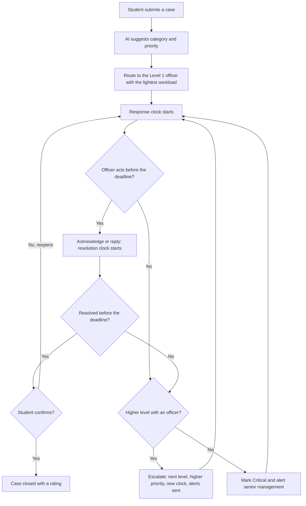
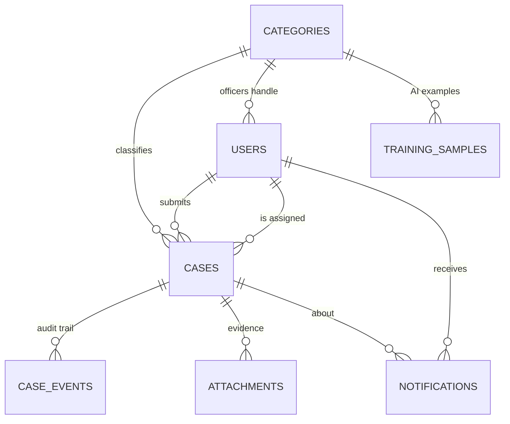

# KIU Complaints & Requests Desk

**Design and Implementation of a Web-Based Complaints and Request Management System with Automated Routing and Escalation Tracking: A Case Study of Kampala International University**

Written in plain PHP and MySQL (no framework), so every file can be read, explained and defended.

## What it does

- Students submit a **complaint or request** (with an optional photo or PDF), with their name or **anonymously**.
- A small **AI model reads the text**, picks the right office and spots urgent cases (harassment, theft, danger).
- Each case goes to the **Level 1 officer** with the lightest workload and gets a **deadline**.
- If the deadline passes, the case **escalates by itself** to the next level, its priority rises, a new clock starts and everyone involved is alerted. At the top level it becomes **Critical** and keeps alerting management until someone resolves it.
- Students **track** every case, then **confirm and rate** the result or **reopen** it.
- Admins see **reports** (response time, resolution time, satisfaction, slow offices) and an **audit trail** of every escalation.

## Install (XAMPP on Windows)

1. Install XAMPP (PHP 8 or newer). Copy the `kiu-crms` folder into `C:\xampp\htdocs\`.
2. Open the XAMPP Control Panel and start **Apache** and **MySQL**.
3. Open **http://localhost/kiu-crms/install.php** once. It creates the database `kiu_crms`, the tables, demo accounts and demo cases.
4. Open **http://localhost/kiu-crms/** and log in. Then **delete `install.php`**.

If your MySQL root user has a password, or you use another port, edit `config/config.php` first.
If pages look unstyled or links break, set `'base_url' => '/kiu-crms'` in `config/config.php`.
To start again from nothing: delete `config/installed.lock`, drop the `kiu_crms` database in phpMyAdmin and open `install.php` again.

## Demo accounts

Every demo password is **`Demo@1234`**. Change them before real use.

| Role | Email | Good for showing |
|---|---|---|
| Admin | `admin@kiu.test` | Dashboard, reports, users, settings, AI classifier |
| Student | `student@kiu.test`, `student2@kiu.test` | Submitting and tracking cases |
| Level 1 officer | `fees.l1@kiu.test`, `registry.l1@kiu.test`, `hostel.l1@kiu.test`, `ict.l1@kiu.test`, `safety.l1@kiu.test` (an urgent case) | Working a queue |
| Level 2 officer | `lecturers.l2@kiu.test` | A case that was escalated once |
| Level 3 | `dean.students@kiu.test` | A case escalated twice |
| Level 4 | `registrar@kiu.test` | A critical case |

Other officers follow the pattern `results`, `fees`, `hostel`, `registry`, `lecturers`, `ict`, `facilities`, `safety` or `general`, then `.l1` or `.l2`, then `@kiu.test`.

## Show the escalation to your panel in two minutes

Real deadlines are 24 hours, so use demo mode:

1. In `config/config.php` set `'sla_unit' => 'minutes'`. (Use `'seconds'` for an even faster demo.)
2. Log in as `admin@kiu.test`, open **Settings** and set every "Respond within" box to **1**. Save.
3. Log in as `student@kiu.test`, submit a complaint (for example "The lecturer does not come for classes") and open the case.
4. Watch the countdown. After about a minute the case moves to Level 2, the priority rises and the page refreshes itself. It keeps climbing to Level 4, then raises critical alerts.
5. Open **Admin > Escalation log** and **Admin > Emails** to show the audit trail and the alerts.
6. Put `sla_unit` back to `'hours'` and the limits back to 24.

## How escalation works

The rules live in `app/Escalation.php`. The engine runs **whenever someone opens a page** (at most every 30 seconds), and from `cron/escalate.php`, so cases escalate on time even when nobody is online. To run it every minute with Windows Task Scheduler, create a task with the program `C:\xampp\php\php.exe` and the argument `C:\xampp\htdocs\kiu-crms\cron\escalate.php`.

| Level | Example handler | Default limit | Priority on arrival |
|---|---|---|---|
| 1 | Responsible office officer | 24 hours (4 if urgent) | Normal |
| 2 | Head of department or section | 24 hours | High |
| 3 | Dean of school or Dean of Students | 24 hours | Urgent |
| 4 | Registrar or DVC's office | 24 hours, then repeated alerts | Critical |

Titles and limits can be changed in **Admin > Settings**. Confirm the real chain with KIU administration.

## The AI part

`app/Classifier.php` is a **Naive Bayes text classifier** written from scratch (no libraries).

1. It learns from example complaints stored in the `training_samples` table (245 to start).
2. For a new complaint it asks which category's examples use the same words, and turns the scores into percentages.
3. The case goes to that office when the AI is at least 40% sure, otherwise to "General and other".
4. When an officer moves a case to the right category, that case is **added as a new example**, so the model improves with use.
5. A separate word list flags **urgent** cases, which get the shorter time limit.

Accuracy on the starting data: about **80%** by leave-one-out testing (Admin > AI classifier > Measure accuracy), and about **91%** on 45 new sentences written separately. These are indicative. For your report, test it on complaints you collect yourself.

## Folder map

| Path | Purpose |
|---|---|
| `index.php`, `register.php`, `login.php`, `logout.php` | Home, sign-up, login |
| `submit.php`, `submitted.php`, `api/suggest.php` | Submit form, receipt slip, live AI hint |
| `my-cases.php`, `case.php`, `case-action.php`, `track.php` | Student pages and the case page used by everyone |
| `officer.php` | Officer queue with live deadlines |
| `notifications.php`, `files.php` | Alerts, protected file downloads |
| `admin/` | Dashboard, all cases, escalation log, users, settings, AI classifier, emails, CSV export |
| `app/helpers.php` | Settings, login, CSRF, time limits, page layout |
| `app/CaseService.php` | Everything that can happen to a case |
| `app/Escalation.php` | The escalation engine |
| `app/Classifier.php` | The AI |
| `app/Notifier.php`, `app/Mailer.php` | In-app alerts and the email queue |
| `database/schema.sql`, `database/training_data.php` | Tables, categories, AI examples |
| `cron/escalate.php` | Command-line escalation runner |
| `tests/e2e_test.py` | Automated system test (optional) |
| `TESTING.md` | Test cases table for Chapter 4 |

## Database

`escalation_levels` (the ladder), `email_outbox`, `login_attempts` and `app_state` stand alone. `case_events` is the audit trail: every submit, routing, reply, escalation and closing is a row.

## Security built in

- Passwords hashed with bcrypt. Five wrong passwords lock an email for 15 minutes.
- Every database query is a prepared statement. Every page output is escaped.
- A secret token on every form (CSRF). Session id renewed at login.
- Role checks on every page. Students see only their own cases. Anonymous cases are opened with a reference number plus tracking code, and wrong guesses are throttled.
- Uploads: JPG, PNG, PDF only, 5 MB, content checked, random file names, kept in a folder the web server refuses to serve, and downloaded only by people allowed to see the case.
- Hidden trap field and a per-computer limit against spam on the anonymous form.
- `.htaccess` blocks direct access to `app/`, `config/`, `database/`, `uploads/` and `cron/`. Personal data handling should follow the Data Protection and Privacy Act, 2019.

## Settings (`config/config.php`)

Database login, `sla_unit` (hours, minutes or seconds), how long before a resolved case closes itself, how sure the AI must be, upload limits, and email. Set `'debug' => false` before real use.

**Real email (optional).** By default every alert is also saved in **Admin > Emails** and nothing is sent. To send real email, run `composer require phpmailer/phpmailer` in this folder, then fill in the `mail` settings (a Gmail app password works). This sending path was not tested in my sandbox. Everything else was.

## Honest limits

- The demo cases and the dashboard figures are **fake**, made only so the screens are not empty. Do not present them as research results. Collect real data from a pilot and compare it with the manual process you describe in Chapter 3.
- Not included (as in your Chapter One scope): SMS and WhatsApp alerts, a mobile app, links to KIU's student portal, and other campuses.
- A Naive Bayes model learns from word counts. It does not understand meaning, so it needs good examples. Add more at **Admin > AI classifier**.

## Screenshots to take for Chapter 4

Home page, submit form with the AI hint showing, receipt slip, a case page with the escalation ladder, officer queue, an escalation in the history, admin dashboard, escalation log, AI classifier results, the emails page, and the Settings page.
